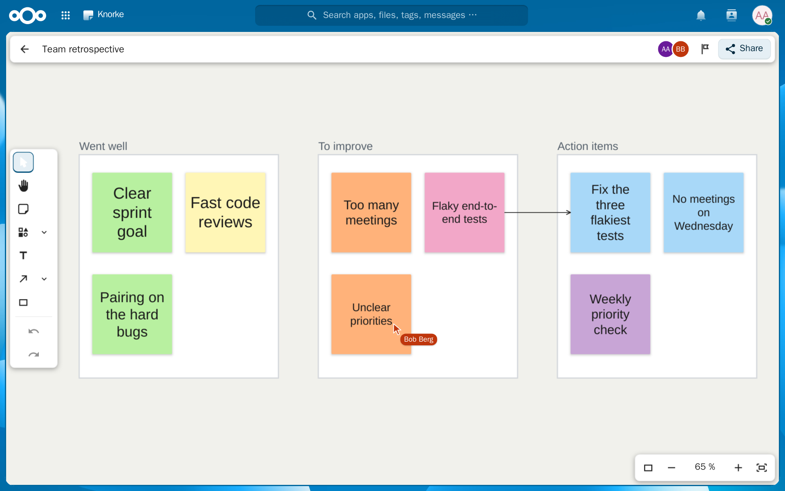

<!--
  - SPDX-FileCopyrightText: 2026 hotochan123
  - SPDX-License-Identifier: AGPL-3.0-or-later
-->
# Knorke – Workshop-Board for Nextcloud

> **Vibe-coded:** Knorke is written by AI coding agents (Anthropic's Claude Code),
> not by hand. The maintainer sets the goals, makes the product decisions and tries
> the app out in the browser; there has been no independent human code review and
> no security audit. Details: [How this app is built](#how-this-app-is-built-ai-disclosure).

Knorke is a collaborative whiteboard for workshops as a native Nextcloud app: an
infinite canvas with sticky notes and frames, live cursors of everybody on the
board, and one edit link per board through which guests join with just a name.
It runs inside your own Nextcloud, without an extra server process.



**Status:** version 0.3.0 is in the Nextcloud App Store. What changed in each
version is in the [changelog](CHANGELOG.md).

- [Features](#features)
- [Requirements](#requirements)
- [Installation](#installation)
- [Known limits](#known-limits)
- [Development](#development)
- [How this app is built (AI disclosure)](#how-this-app-is-built-ai-disclosure)
- [Licence](#licence)

Every feature in detail: [`docs/FEATURES.md`](docs/FEATURES.md). Settings,
`occ` commands and all known limits for administrators:
[`docs/ADMIN.md`](docs/ADMIN.md).

## Features

- **Canvas:** sticky notes, frames, shapes, text and connectors on an infinite
  board; zoom from 5 to 400 %, smooth on boards with thousands of notes.
- **Live together:** everyone's cursors, selections and drags in real time;
  nobody silently overwrites what someone else is typing.
- **Guests with just a name:** an edit link and a voting link per board, each
  with an optional password and expiry date, a QR code and a full-screen view
  for the projector.
- **Sharing** with people, groups and teams, with the roles "Can facilitate",
  "Can edit", "Can vote" and "Can view".
- **Facilitation:** dot voting (anonymous, optionally with a time limit), a
  timer everyone sees, "Bring everyone here" and following a participant's
  view.
- **Tidy boards quickly:** snapping with guides, a background grid, align,
  distribute and tidy up, grouping and locking.
- **Part of Nextcloud:** boards in Nextcloud's search, and notifications when
  someone shares a board with you.
- **Touch and pen:** tablets with a pen edit like a computer, a finger pans,
  zooms and selects; phones and tablets without a pen view and vote.
- **Keyboard:** shortcuts for every tool, Tab through the items, undo and redo
  of up to 50 steps.
- **Languages:** English and German.

## Requirements

Nextcloud 34 or 35, PHP 8.2–8.5, and PostgreSQL, MySQL/MariaDB or SQLite (not
Oracle). Redis as Nextcloud's distributed cache is strongly recommended:
without it Knorke works through the database alone, but without live cursors
and the list of people on the board, and without write budget or daily quotas.

## Installation

An administrator installs Knorke from the Nextcloud App Store: on the Apps
page of Nextcloud, search for "Knorke". Two settings are worth a look right
away:

- **Link address for guests.** Links and QR codes use the address the board
  was opened with. If guests reach your Nextcloud under another address, set
  it once: `occ config:app:set knorke public_url --value=https://cloud.example.org`.
- **Privacy notice for guests.** Guests see it when they join; administrators
  edit it under "Administration settings", section "Knorke".

Installing from the repository, updates, every setting and the `occ` commands
are described in [`docs/ADMIN.md`](docs/ADMIN.md).

## Known limits

The most important ones; the full list is in
[`docs/ADMIN.md`](docs/ADMIN.md#known-limits).

- **Guest votes are not one per person.** A guest who clears the browser votes
  again with a new identity; accounts vote once per board.
- **Votes from two tabs.** One person voting in two tabs or on two devices can
  lose a vote when more than one vote per item is allowed (with one vote per
  item, the default, it does not happen).
- **Guests behind one network address share their limits.** Knorke counts wrong
  link passwords and new guests per IP address, so all guests on one venue
  Wi-Fi share them.
- **Do not revoke, renew or protect a link during a session with many guests on
  one network.** Proxies with brute-force rules (for example CrowdSec) may then
  ban the whole network of the room for hours.
- **iPad and Safari have not been measured on real hardware.** Large boards may
  draw more slowly there.
- **Up to 5000 items per board**, connectors included.
- **Not yet:** templates, export, comments, a minimap, search within a board,
  mind maps, images, rich text, an activity log and undo across reloads.

## Development

```
npm ci && npm run build     # the bundle in js/ and css/ (Node.js 22.18, npm 10.9)
npm test                    # JavaScript unit tests
npm run l10n:check          # translations complete
tests/php/run.sh unit       # PHPUnit in a throwaway container
```

The development stack, the HTTP contract suite, the convergence run, the
browser scenarios, the scene lab and the release steps are described in German
in [`docs/ENTWICKLUNG.md`](docs/ENTWICKLUNG.md), the architecture in
[`docs/ARCHITEKTUR.md`](docs/ARCHITEKTUR.md) and the sync protocol in
[`docs/PROTOKOLL.md`](docs/PROTOKOLL.md). [`docs/SPEC-M1.md`](docs/SPEC-M1.md)
is the specification of version 0.3.0.

## How this app is built (AI disclosure)

Knorke is vibe-coded. The maintainer ([hotochan123](https://github.com/hotochan123))
does not write the code by hand. They set the goals, make the product decisions
and try the app out in the browser. Everything else is written by AI coding
agents:

- all code – PHP, JavaScript/Vue, CSS and the database migrations;
- the tests and the development tools (dev stack, HTTP contract suite,
  convergence run, browser scenarios, scene lab);
- the documentation, including this README, and the German translation.

**Tool and models.** The agents run in Anthropic's Claude Code. Every commit of
the development history, except the automatic merges of `main` into a job's
branch, carries a `Co-Authored-By` trailer naming the model: up to version 0.3.0
(12 to 23 October 2026), Claude Opus 5.5 (478 commits) and once Claude Sonnet 5.5.

**How a change is made.** The maintainer decides what goes in, in question
rounds with an agent. Each feature then runs as one job of an automated
pipeline: agents write a short specification with acceptance criteria, build
the change with tests and run the checks; agents that did not build it review
it for correctness, security and usability, and only then is it merged. The maintainer tries the
result in the browser.

**Verification.** Knorke is checked by PHP unit and integration tests,
JavaScript unit tests, an HTTP contract suite and a convergence run with fault
injection against a running Nextcloud, browser scenarios with Playwright (also
at phone and tablet sizes) and a scene lab with deterministic rendering gates.
All of them are written by the same AI agents, so they check the code against
the agents' own reading of the specification. CI
(`.github/workflows/ci.yml`) builds the bundle, checks the translations, the
runtime dependencies (`npm audit`) and `info.xml` against the App Store schema,
and runs the JavaScript unit tests, the self-tests of the test harness, a
syntax check of every script and PHPUnit on Nextcloud 34 and 35. The contract
suite, the convergence run, the browser scenarios and the scene lab need a
running Nextcloud and are run by hand. Before releases, AI agents of the same
kind reviewed the changes for security and correctness; the fixes are listed in
the [changelog](CHANGELOG.md). There has been **no independent human code
review and no security audit.** How to report a problem:
[`SECURITY.md`](SECURITY.md).

**History.** This public repository is exported from the private development
repository at each release; the development history, with the job files of the
pipeline, stays private. The code is the same.

**What this means for you.** Evaluate Knorke yourself before you rely on it,
especially before you open boards to guests from the internet. Issues and
reviews are welcome
([issue tracker](https://github.com/hotochan123/nextcloud-knorke/issues)).

## Licence

AGPL-3.0-or-later, see [`LICENSE`](LICENSE). Knorke comes without any warranty.
The licences of the bundled JavaScript libraries and icons are listed in
[`THIRD-PARTY.md`](THIRD-PARTY.md).

Knorke is an independent project and is not affiliated with any other product
or company of a similar name.
